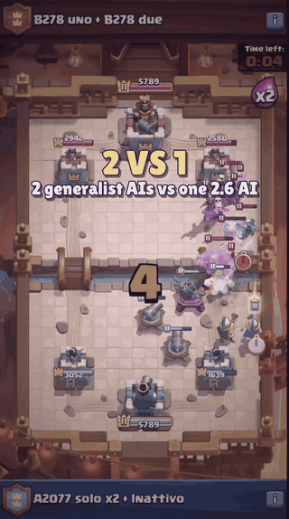
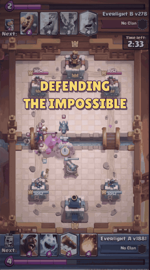
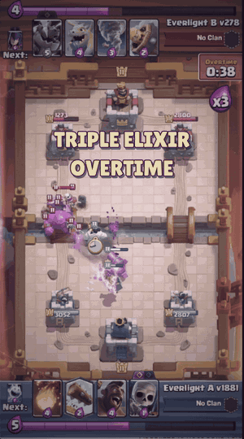
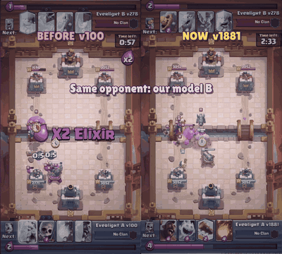

# RoyaleFish

An open, community-driven Clash Royale AI. The idea is simple: something like Stockfish, but for Clash Royale. A strong engine that anyone can download, play against, study and make stronger. When someone trains a better model, it gets added here and becomes the new baseline for everyone.

Everything runs offline, in a local simulation.

> [!IMPORTANT]
> **Benchmarking or comparing models? Run every model on the same 16.635 card data.**
> All current models are trained on game data **16.635** (the tables in `data_16635/`, with the patch in `patches/native_runner_16635.diff`). A model trained on the older 15.535 tables reads cards in a different order, so if one side of a match uses the old tables and the other the new ones, one of them is effectively seeing the wrong cards and the result means nothing.
> - Convert older models to 16.635 first (a conversion script is coming to this repo soon), then run both sides on a 16.635 native engine.
> - Don't run the new models on an older engine/data version either. They were trained on the current balance (30+ card balance changes since the old data), so on old stats they play cards that no longer behave as they learned.

## 2 vs 1: two generalist AIs against one 2.6

  

Two generalist B v278 models (top) against our single Hog 2.6 model (bottom, latest checkpoint A v2077). <a href="media/2v1-overtime-hd.mp4">Watch in HD</a>.

**Two minds attacking. One defending.**

We modified the offline engine so that **two generalist B models play on the same side**, on a normal 18x32 arena, against our single Hog 2.6 model. Both B's played the same spam deck (Elixir Golem, Evo Witch, Evo Electro Dragon).

The only advantage our AI gets is elixir: each B gets 1x and ours 2x, and in the last minute each B gets 2x and ours 3x. More than each of them, never more than both combined. With the same elixir as each opponent, holding two full pushes at once would be mathematically impossible.

In overtime both B's sent everything at once. The tower went from **1639 to 910**, and it held.

## The next A is coming: it learned to defend from real humans

  
  &nbsp;&nbsp;
  

A v1881 (blue) vs our generalist B v278. Left: a non-stop push, towers untouched. Right: the last 40 seconds of triple elixir overtime. <a href="media/v1881-defense-hd.mp4">Watch the full clip in HD</a>.

### Before and after, side by side

  

Left: the old A v100. Right: the new A v1881. Both against our generalist model B v278. <a href="media/v100-vs-v1881-hd.mp4">Watch in HD</a>.

**Keep in mind what v100 already was.** It comes from Everlight, it was trained with imitation learning on **6,500 human Hog 2.6 replays**, then **134 updates** of reinforcement learning (Everlight RL), then **100 more** of our own: about **234 RL updates on top of 6,500 pro games**. And still, in the clip on the left it puts the Cannon in the wrong spot, the Elixir Golem walks straight to the tower, and in overtime it loses a tower. That tells you how far the original Everlight was from playing well.

On the right, v1881 faced **much heavier pushes** in its game, and still kept its towers.

**Result of the two games:** v100 **lost a tower**. v1881 **never let a single troop touch its towers**: the only tower damage in its whole game came from spells (a Poison on the tower, −245, and a 25 HP chip in overtime).

### RoyaleFish is not the original Everlight

The models still say "Everlight" in the name because that is where they started, but what you see here is not the original model copied as it is:

- **Retrained from the first weight to the last.** Compared to the Everlight checkpoint we started from, **99% of its 17.5 million weights have changed**.
- **About 1,900 updates.** Each update is **64 full games** (around 45,000 decisions), so the model has learned from **more than 120,000 games** of reinforcement learning. Against the human ghosts alone it has already played **73,000+ games against 27,000+ different real attacks** (out of the 52,632 available).
- **The easiest way to tell them apart: the Musketeer's ability.** The original Everlight almost never uses it (in our logs the early versions used it **0 times per game**). RoyaleFish uses it as a normal part of its defense, **several times per game**, at the right moment.

**What looks like a lost tower to you is just a calculation to it.**

This is not a small update. The old A could play, but when a real push came it panicked: wrong card, wrong timing, tower gone. The new A treats every push like a math problem. It times the Cannon so the Golem breaks right on it, Logs the Witch at the exact moment, drops Skeletons and Ice Spirit to finish the job, and walks out of situations that looked lost. In the first clip the towers stay at **3052 / 3052** under non-stop spam.

**How:** we took the full public replay set (252,238 matches) and kept the side that **won against a light cycle deck**, 52,632 real human attacks: 7,759 of them beat the Hog 2.6, the rest beat other light cycle decks, with extra weight on the 2.6 ones and on heavy decks (4.0+). Each of these attacks is replayed card by card, with the exact same hand order as in the real game, as a "ghost" opponent. A defends against the same ghost 4 times and is rewarded for doing better than its own other attempts, the training idea used by [vegetableleaf's ClashAI](https://github.com/vegetableleaf/ClashAI). 2,666 ghosts are never used in training and are kept only for testing.

Measured on those **never-seen** human attacks:

| Version | Defense score (1 = no tower damage) | Princess towers lost per game | Fully clean defenses |
|---|---|---|---|
| v1329 (before) | 0.53 | 0.47 | 11% |
| **v1881 (new)** | **0.75** | **0.25** | **19%** |

**About half the tower damage it used to take.** And it is still improving while training.

What is fixed and what is not, from our own testing:

- **Fixed:** collapsing against big pushes (Golem, Goblin Giant + Sparky, Dark Prince, spam in triple elixir). It now defends them cleanly most of the time.
- **Still open:** it attacks too little and almost never commits the Hog Rider, because this training only rewarded defense. Next round brings attack back without losing the defense.
- **Still open:** its Fireball sometimes lands a bit behind moving troops (it aims where they are, not where they will be).

**Release:** v1881 is out, see `models/A-hog26-v1881.pt` in the table below.

**What's next:** we kept training up to v2112. It scored even higher on our ghost test (0.81), but in real games we liked v1881 more: some of v2112's plays were just bad, which tells us the ghost score alone doesn't catch everything. So the next round restarts from v1881, and every new version will also be tested against reacting opponents before it gets released.

## Models

| File | Deck | Card data | What it is |
|---|---|---|---|
| `models/A-hog26-v1881.pt` | Hog 2.6 | **16.635** | **Latest.** The ghost-trained defender from the clips above: defends real human pushes far better than every previous version. Attacks less, that's next. |
| `models/A-hog26-v738.pt` | Hog 2.6 | **16.635** | Previous Hog 2.6 specialist (738 PPO updates). Knows the Minion Giant and the Hero Ice Wizard (see below). |
| `models/B-general-v275.pt` | many decks | **16.635** | Latest generalist, A's main sparring partner, 275 PPO updates. |
| `models/A-hog26-v98.pt` | Hog 2.6 | 15.535 | Older Hog 2.6 specialist (98 updates), kept as a reference. |
| `models/B-general-v49.pt` | many decks | 15.535 | Older generalist (49 updates). |

Both are the same network: a recurrent V4 actor-critic (transformer over cards and units, spatial encoder for the arena, LSTM memory), about 17M parameters. They load with `load_policy_v4` from the V4 framework (see Requirements).

How much did the fine-tuning help? Two tests of A at update 98 against its own starting checkpoint:

| Test | Games | A v98 | Starting checkpoint |
|---|---|---|---|
| Head to head (each side plays Hog 2.6 in turn, the other plays varied decks) | 1,056 | **54.3%** | 45.7% |
| Both play Hog 2.6 against the same opponent (the original generalist, same deck sequence) | 600 / 561 | **59.7%** win rate | 49.6% win rate |

So against the same opponent, the fine-tuned model wins about 10 percentage points more often than the checkpoint it started from.

Later versions, same test (both play Hog 2.6 against the original generalist, same deck sequence):

| Model | Games | Win rate vs original generalist |
|---|---|---|
| Starting checkpoint | 561 | 49.6% |
| A v98 | 668 | 61.2% |
| A v357 | 668 | **73.1%** |

A v357 more than doubled the gain over the starting checkpoint (+23.5 points, against +11.6 for v98).

**A v738, measured:** both sides play Hog 2.6, A v738 against the original model it started from, sides swapped: **71.9% (±2.6) over 1,147 games**.

## What's new in v738

**New card data (game version 16.635).** The original card catalog stopped at 122 cards, so the models saw newer content as an "unknown card". The catalog is now rebuilt from 16.635 data:

- **Minion Giant** is a real card for the model: it knows it flies, targets only buildings, costs 4 and how much HP it has. Its new embedding starts from the Balloon's.
- **Hero Ice Wizard** is supported, with its ability (`IceWizardHero_ability`). This one is **still early**: the ability is offered and used, but the model has only just started learning when to use it.
- The newer 16.635 mechanics (new effects and abilities) are in the catalog too.
- All 122 cards the model already knew keep their learned weights: they were moved to the new table row by row, nothing was retrained from scratch.

Loading these models needs the 16.635 tables in `data_16635/` and the small framework patch in `patches/native_runner_16635.diff` (wider catalogs, 26 ability slots, 453 unit archetypes). Point `CR_COMPETITIVE_DATA_ROOT` at `data_16635/`.

**Training changes:**

- **Musketeer turret.** Hero abilities were never offered to the models in the x86 engine; that is fixed. A also gets a small reward for using the Hero Musketeer turret at the right moment (a building-targeting win condition near its tower and no building of its own on the field).
- **Opponent spell reward.** The opponent gets a small reward when its Fireball, Arrows or Lightning kills A's Musketeer, so A learns to protect it.
- **Tower damage.** The per-hit tower damage term was raised, so small chip damage on the other lane is no longer ignored.
- **Focus decks.** About 30% of games are played against the decks A struggled with: Mortar, Evo Witch and Minion Giant decks, mostly real meta lists.

In-training win rates of A (last hour of training, not a paired evaluation):

| Opponent | Win rate |
|---|---|
| Original generalist (frozen) | about 59% |
| Older generalist B v50 (frozen) | about 55% |
| Minion Giant decks | 32% → **48%** |
| Mortar decks | 39% → **48%** |
| Evo Witch decks | 32% → **45%** |

## A since v738: what was wrong and what changed

Weaknesses found by playing against v738, and where they stand now (numbers from training, A at around 1,300 updates):

| Problem | Status | Numbers |
|---|---|---|
| **Wasting the only counter** (Cannon thrown at the bridge on Mega Knight, then the Hog Rider walks in on the other lane) | **Improved** | When the opponent sends a second win condition on the other lane right after A's Cannon, A now holds that tower **45–50%** of the time, up from **26%**. The opponent is rewarded for trying exactly this, so A sees it a lot. |
| **Wasted Musketeer turret** (activated with nothing in range, e.g. at the bridge) | **Fixed** | Turret activations with nothing to hit: about **4.4 → 0.6 per game**. Useful activations (something in range, including predicts like a Tesla about to land): about **4.7 per game**. The Cannon is not dropped: still about **5 per game**. |
| **Fireball / Lightning taking two key cards** (Musketeer and Cannon next to each other) | **Improved** | Spells hitting Musketeer + Cannon together: **0.36 → 0.04 per game**. Ice Golem next to the Hog or the Musketeer is fine and is not counted. |
| **Ignoring damage on the other lane** | **Improved** | Tower damage now weighs more in the reward (0.35 → 0.5) and the double-threat check above measures exactly this. |
| **Log Bait** (Log spent before the Goblin Barrel) | **Improved, not solved** | Against our Log Bait model: 58% → **66–75%**. Against other Log Bait players it can still lose badly, so it stays on the list. |
| **Musketeer turret at the right moment** | **Fixed** | 13% of the chances before v738 → about **45%**. |
| **Fireball on high-value troops** (Princess, Evo Firecracker, Dart Goblin, Musketeer…) | **In progress** | New small reward when its Fireball kills them or leaves them almost dead. No reward for small troops like Skeletons. |

Still open: Lava Hound and Balloon pushes, the Minion Giant getting 3–4 hits on the tower, and the Evo Royal Giant.

**What changed in training:** opponents are no longer frozen. A plays the generalist B, which **keeps learning** how to beat the current A, plus older versions of A and B picked at random every 10 minutes, plus mirror games. A frozen opponent can be "solved" by memorizing it; one that keeps learning keeps finding the holes.

## Coming next

**New A (Hog 2.6), around 1,300 updates (v1290).** Uploading soon. Fixes from testing it are being added now, for example:

- **Musketeer turret against the Hog Rider:** reward it only when the Hog Rider actually targets the turret, and penalize activating it when a win condition is already hitting the tower (too late to pull it).
- **Ice Wizard / support troops thrown in front:** a small elixir-trade term, so losing a 3-4 elixir support troop for nothing costs something.

**Imitation learning on fresh pro replays (next step).** We are collecting **November 2026 Hog 2.6 replays from top players**: mostly Path of Legends top 1,000 / Ultimate Champion players who play the 2.6, plus a few hand-picked strong 2.6 players. Only games where one side plays at least 7 of the 8 2.6 cards are kept. The collector runs slowly (one request every 10 seconds) so it stays within RoyaleAPI's limits. Once there are a few thousand games, A gets a round of imitation learning on them (more weight on the moments the pro actually plays a card), then reinforcement learning again. Progress will be measured on held-out November replays the model has never seen, not only on win rates against our own training opponents.

**Update (16 Nov 2026): RoyaleAPI closed replay access for everyone.** Replays now need a Discord login and a special access request form, reviewed by hand, with no idea how long it takes or who gets accepted. Our collection stopped at a few hundred November games, so the imitation step is on hold and the Hugging Face upload is postponed.

**The replays will be public too.** When the collection is done (around 5,000–10,000 Hog 2.6 games), the whole set will be uploaded to Hugging Face so anyone can download it and use it as they like: a snapshot of the **mid-November 2026 meta** played by top players. Replay data comes from RoyaleAPI, which will be credited.

**Frost (new model, in 1–2 days).** A model specialized in one deck:

`knight-ev1`, `ice-wizard-hero`, `tesla-ev1`, `bats`, `minion-giant`, `skeletons`, `barbarian-barrel`, `fireball`

It starts from our anti-2.6 model (which reached 81% against our 2.6) and now trains against the learning generalist B, older versions of A and B, and a small share of our 2.6. It gets rewarded for the parts of this deck that matter most:

- **Hero Ice Wizard freeze:** a reward when it freezes an incoming win condition (more if the freeze catches a whole push), nothing for freezing an Ice Golem alone, a penalty for freezing nothing.
- **Tesla on defense:** a reward when the Tesla pulls a win condition and the tower takes no damage, a penalty when a win condition hits the tower while it has the Tesla in hand and the elixir to play it.
- **Two win conditions in a row:** like A, it has to hold the second lane after spending its building.

First hours of training:

| | Start | Now |
|---|---|---|
| Freezes on a win condition, per game | 0.44 | **1.03** |
| of which catching a whole push | 0.26 | **0.71** |
| Wasted freezes, per game | 1.85 | **0.69** |
| Tesla defenses that keep the tower clean | — | about **60%** |
| Holding the second win condition | 48% | **56%** |
| Against our 2.6 | — | about **60–75%** |
| Against the learning generalist B | — | about **31–37%** (still the hard part) |

**Conversion script.** The script we use to move models between card data versions (15.535 → 16.635) will be added, so older or community models can be compared fairly.

## How training works

A trains against a league: a generalist B that keeps learning at the same time, older versions of A and B, and mirror games. The interesting part is how much data fits through one machine. On a single PC with an RTX 5060 Ti (for playing) and a Tesla V100 (for learning), the system plays **about 2,500–3,000 complete games per hour**. Each update trains on **~55,000 decisions from ~64 full games** in a single optimizer step and takes about 70–90 seconds.

That speed comes from a few changes:

1. **Native engine, no emulators.** Matches run in a resident native battle engine (16 matches per engine process, 32 processes, 512 matches at once) instead of Android emulators.
2. **Fast inference servers** (`ever_server.py`). The collectors send observations as one packed byte block per move. The server runs the model with CUDA graphs captured at several batch sizes, in fp16 (checked to choose the same actions as fp32), and keeps every match's LSTM state in a single GPU table, so it is read and written once per batch instead of once per match.
3. **Pipelined collectors** (`ever_collector.py`). Each collector splits its matches in two halves: while one half waits for the model, the other advances the engine. Moves are placed exactly where the model chose. If a cell is not legal under the game rules, the move is simply not played; it is never moved to a nearby cell.
4. **Sparse trajectories.** Finished games are stored losslessly in a sparse format (about 8 KB per move instead of ~180 KB).
5. **Row-packed learner** (`ever_learner.py` and `ever_packed.py`). Trajectories are handed to the PPO update in the packed, one-buffer-per-dtype layout the update code is optimized for. Before this, the update spent half its time rebuilding observations move by move on the CPU, and switching gave a **4x faster update**.
6. **Loader in a separate process** (`ever_loader.py`). The next group of games is decoded in another process and shared through memory while the GPU trains on the current group. Games are grouped by length, so very little compute goes to padding.
7. **One big step per update.** Four groups of 16 games accumulate gradients, then one clipped optimizer step, which matches the size of the original large-scale PPO updates.
8. **KL anchor.** A small KL term towards the starting checkpoint, computed on half of the groups, keeps the models from forgetting what they already know.
9. **Opponent choice.** A learning opponent plus older versions, focus decks picked automatically from the cards A loses to most, drills and 10% mirror games.
10. **NVIDIA MPS.** All model servers share the playing GPU at the same time instead of taking turns, which almost doubled the games per hour.

## Our machine

Everything above was trained on one home PC:

| Part | What | Used for |
|---|---|---|
| CPU | 2 × Intel Xeon E5-2695 v4 (2 × 18 cores, 72 threads) | the native battle engines and the collectors (30 engines × 16 games = 480 games at once) |
| RAM | 128 GB | engines, collectors and replay loading |
| GPU 1 | NVIDIA RTX 5060 Ti 16 GB | inference: plays the moves for all running games (fp16, CUDA graphs) |
| GPU 2 | NVIDIA Tesla V100 16 GB | training: PPO updates and imitation learning |

Most of the speed comes from the many CPU cores: every game runs on the CPU, and the GPUs answer hundreds of games in one batch.

## Requirements

- Python 3.12 with PyTorch and a CUDA GPU.
- The open-source V4 framework listed in `NOTICE`. The `royalefish/` package imports its `native_runner` modules.
- **A native battle engine, which you have to supply yourself.** This repository does not include any game binaries, resources, modified clients or engines, and never will.

### Source changes for a 16.635 engine

Source code only, no game files, in the same spirit as the 15.535 probe sources published by FirstLight CR:

| File | What it is |
|---|---|
| `patches/native_runner_16635.diff` | Python framework changes: 16.635 catalogs (123 cards, 453 unit archetypes, 26 ability slots), Minion Giant and Hero Ice Wizard support, relaxed identity checks. Apply on top of the FirstLight CR `native_runner/`. |
| `patches/probe_x86_64_16635.diff` | Native probe changes against the FirstLight CR `native_runner/probe/`: x86_64 port (inline hooks in `x86_hook.h`, `native_call_x86_64.cpp` replacing the AArch64 assembly), generated x86 → ARM address tables (`logical_*.inc`), the hero ability fix (abilities were never offered: the charge check read the wrong field), resident multi-match engine and the `test_x86.cpp` host. |
| `data_16635/` | The 16.635 card tables the models were trained on. Point `CR_COMPETITIVE_DATA_ROOT` here. |

Notes:

- The address tables match the x86_64 game library of the 16.635.1 build we use. A different build needs regenerated tables.
- `test_x86.cpp` expects your own files in `./game_libs/`, `./game_assets/` and `./game_data/`. Nothing of that is included.
- Build: clang++ from the Android NDK, target `x86_64-linux-android24`, as a shared library (`libcrprobe.so`) plus the host executable.

The scripts are configured with command-line arguments and the `RF_*` environment variables in `royalefish/config.py`. Each script's `--help` lists its options.

## Contributing a model

If you train something stronger, on any deck, open a pull request. Please include:

- the checkpoint (or a link to it if it's too big) and the deck it plays;
- a head-to-head result against the current model for that deck: at least 400 games, with both sides swapped;
- a short note on how you trained it (starting point, number of updates, anything unusual).

If it's better, it goes in the table above and becomes the new baseline. Specialists for other decks are just as welcome. The long-term goal is an offline training mode where you can practice against the AI at different difficulty levels.

## License

Apache-2.0. See `LICENSE` and `NOTICE`. Not affiliated with, endorsed by, or representative of Supercell.

---

## ⛔ NOT FOR RANKED, LADDER OR ANY ONLINE PLAY

> [!CAUTION]
> **RoyaleFish must never be used in the real game.** Not in ladder, not in Path of Legends, not in tournaments, not on any account, for any reason.
>
> - It is a **research project**: it plays only offline, in a local simulation, against other models or against you.
> - Using an AI to play ranked games for you is **cheating**. It ruins the game for real people who are playing fair, and it breaks Supercell's Terms of Service.
> - **I do not support it, I condemn it, and I take no responsibility** for anyone who tries.
>
> **If I find out that this AI is being used to climb the ladder (with the 2.6 or anything else), the project goes private for good.** No more updates, no more improvements, no more models released online. I will keep working on it privately, but nothing will ever be published again.

### Do not contact me for:

- **paying me** for models, accounts, boosting or anything else;
- **the game engine** (it is not mine to share and it will not be shared);
- **tools that read a phone's memory or play on a real device** in place of a player.

**Messages like these will be blocked and reported.**

