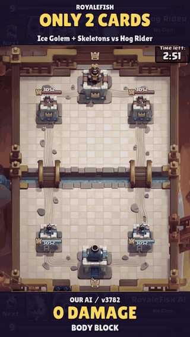

# RoyaleFish

> [!CAUTION]
> **This project is over forever, because of that failure Claude, who can't do anything right.**

An open, community-driven Clash Royale AI. The idea is simple: something like Stockfish, but for Clash Royale. A strong engine that anyone can download, play against, study and make stronger. When someone trains a better model, it gets added here and becomes the new baseline for everyone.

Everything runs offline, in a local simulation.

> [!IMPORTANT]
> **Benchmarking or comparing models? Run every model on the same 16.635 card data.**
> All current models are trained on game data **16.635** (the tables in `data_16635/`, with the patch in `patches/native_runner_16635.diff`). A model trained on the older 15.535 tables reads cards in a different order, so if one side of a match uses the old tables and the other the new ones, one of them is effectively seeing the wrong cards and the result means nothing.
> - Convert older models to 16.635 first (a conversion script is coming to this repo soon), then run both sides on a 16.635 native engine.
> - Don't run the new models on an older engine/data version either. They were trained on the current balance (30+ card balance changes since the old data), so on old stats they play cards that no longer behave as they learned.

## Only 2 cards: Ice Golem + Skeletons vs Hog Rider, 0 damage

  

Our Hog 2.6 model (A v3782) with only Ice Golem and Skeletons playable. <a href="media/only-2-cards-hd.mp4">Watch in HD</a>.

**The Hog never touches the tower.**

People shared a clip of an AI body-blocking a Hog Rider with just Ice Golem and Skeletons, so we tested it on the offline engine. First a brute-force search: the engine tried 88,000 Golem + Skeleton placements and timings against a lone Hog. About 0.3% of them stop it with zero damage, and all 213 we re-tested repeated it 10 out of 10 times. The trick is real, and it is frame-tight.

Then we trained A on a drill: one Hog at the bridge, only those two cards in hand, minus one point for every hit on the tower. Nobody gave it the coordinates. It found its own block: Skeletons in front of the tower about 1.2 s after the Hog is placed, then the Ice Golem right behind them. On the right bridge it now gets zero damage in about 1 drill out of 6, and only one hit in most of the others. The left bridge is still being learned, because the engine is not mirror-symmetric and the right-side block does not work there.

## 2 vs 1: two generalist AIs against one 2.6

  

Two generalist B v278 models (top) against our single Hog 2.6 model (bottom, latest checkpoint A v2077). <a href="media/2v1-overtime-hd.mp4">Watch in HD</a>.

**Two minds attacking. One defending.**

We modified the offline engine so that **two generalist B models play on the same side**, on a normal 18x32 arena, against our single Hog 2.6 model. Both B's played the same spam deck (Elixir Golem, Evo Witch, Evo Electro Dragon).

The only advantage our AI gets is elixir: each B gets 1x and ours 2x, and in the last minute each B gets 2x and ours 3x. More than each of them, never more than both combined. With the same elixir as each opponent, holding two full pushes at once would be mathematically impossible.

In overtime both B's sent everything at once. The tower went from **1639 to 910**, and it held.

## A v1881: it learned to defend from real humans

  
  &nbsp;&nbsp;
  

A v1881 (blue) vs our generalist B v278. Left: a non-stop push, towers untouched. Right: the last 40 seconds of triple elixir overtime. <a href="media/v1881-defense-hd.mp4">Watch the full clip in HD</a>.

### Before and after, side by side

  

Left: the old A v100. Right: the new A v1881. Both against our generalist model B v278. <a href="media/v100-vs-v1881-hd.mp4">Watch in HD</a>.

**Keep in mind what v100 already was.** It comes from Everlight, it was trained with imitation learning on **6,500 human Hog 2.6 replays**, then **134 updates** of reinforcement learning (Everlight RL), then **100 more** of our own: about **234 RL updates on top of 6,500 pro games**. And still, in the clip on the left it puts the Cannon in the wrong spot, the Elixir Golem walks straight to the tower, and in overtime it loses a tower. That tells you how far the original Everlight was from playing well.

On the right, v1881 faced **much heavier pushes** in its game, and still kept its towers.

**Result of the two games:** v100 **lost a tower**. v1881 **never let a single troop touch its towers**: the only tower damage in its whole game came from spells (a Poison on the tower, −245, and a 25 HP chip in overtime).

### RoyaleFish is not the original Everlight

The models still say "Everlight" in the name because that is where they started, but what you see here is not the original model copied as it is:

- **Retrained from the first weight to the last.** Compared to the Everlight checkpoint we started from, **99% of its 17.5 million weights have changed**.
- **About 1,900 updates.** Each update is **64 full games** (around 45,000 decisions), so the model has learned from **more than 120,000 games** of reinforcement learning. Against the human ghosts alone it has already played **73,000+ games against 27,000+ different real attacks** (out of the 52,632 available).
- **The easiest way to tell them apart: the Musketeer's ability.** The original Everlight almost never uses it (in our logs the early versions used it **0 times per game**). RoyaleFish uses it as a normal part of its defense, **several times per game**, at the right moment.

**What looks like a lost tower to you is just a calculation to it.**

This is not a small update. The old A could play, but when a real push came it panicked: wrong card, wrong timing, tower gone. The new A treats every push like a math problem. It times the Cannon so the Golem breaks right on it, Logs the Witch at the exact moment, drops Skeletons and Ice Spirit to finish the job, and walks out of situations that looked lost. In the first clip the towers stay at **3052 / 3052** under non-stop spam.

**How:** we took the full public replay set (252,238 matches) and kept the side that **won against a light cycle deck**, 52,632 real human attacks: 7,759 of them beat the Hog 2.6, the rest beat other light cycle decks, with extra weight on the 2.6 ones and on heavy decks (4.0+). Each of these attacks is replayed card by card, with the exact same hand order as in the real game, as a "ghost" opponent. A defends against the same ghost 4 times and is rewarded for doing better than its own other attempts, the training idea used by [vegetableleaf's ClashAI](https://github.com/vegetableleaf/ClashAI). 2,666 ghosts are never used in training and are kept only for testing.

Measured on those **never-seen** human attacks:

| Version | Defense score (1 = no tower damage) | Princess towers lost per game | Fully clean defenses |
|---|---|---|---|
| v1329 (before) | 0.53 | 0.47 | 11% |
| **v1881 (new)** | **0.75** | **0.25** | **19%** |

**About half the tower damage it used to take.** And it is still improving while training.

What is fixed and what is not, from our own testing:

- **Fixed:** collapsing against big pushes (Golem, Goblin Giant + Sparky, Dark Prince, spam in triple elixir). It now defends them cleanly most of the time.
- **Still open:** it attacks too little and almost never commits the Hog Rider, because this training only rewarded defense. Next round brings attack back without losing the defense.
- **Still open:** its Fireball sometimes lands a bit behind moving troops (it aims where they are, not where they will be).

**Release:** v1881 is out, see `models/A-hog26-v1881.pt` in the table below.

## Update (19 Nov 2026): the next A, coming soon

### What was wrong with v1881 (and the versions right after it)

Found by playing against it and from the training logs:

- **Wasted Cannons.** It often dropped the Cannon early, with no win condition coming. In the versions trained after v1881 this reached about **5 wasted Cannons per game**, and opponents learned to spell them.
- **Almost no attack.** The ghost training only rewarded defense, so it rarely committed the Hog Rider: about **0.9 Hog Riders per game**.
- **Fireball on cheap troops in its own half.** For example a half-HP Ice Wizard that already crossed the bridge, where Cannon, Musketeer or Skeletons would do the job. An old reward paid it for killing support troops anywhere, so we were teaching it that.
- **Fireball behind moving troops** (it aims where they are, not where they will be).

### What the new A does better

Numbers from training against our generalist B (frozen, light modern decks):

| | Before | Now |
|---|---|---|
| Wasted Cannons per game | about 5 | **about 1** |
| Cannons used on a win condition per game | – | **3.75** |
| Hog Riders played per game | 0.9 | **3.8** (about 2 tower hits) |
| Win rate against B | 12% | **42%** |

**The key fix was where the reward lands.** Whether a Cannon was useful is only known when it disappears, up to 30 seconds later. The reward used to arrive at that moment, about 120 decisions after the Cannon was played, so almost nothing of it reached the actual decision. Now the reward is written back **on the exact move that played the Cannon**: +1.5 if a win condition came into its range, −1.5 if it was wasted. The same idea is now being used for the Fireball: a reward for hitting support troops (Ice Wizard, Magic Archer, Princess…) in the opponent's half, a small penalty for a Fireball in its own half that destroys less than 4 elixir of troops (unless it is overtime or its tower is almost down).

From our own games against it: it now uses the Cannon in the right spots, defends Mortar decks well, and in the 2.6 mirror it tracks your cycle, for example Logging your Skeletons before you even play them.

**Not ready yet:** its defense score on never-seen human ghosts is **0.67-0.68** right now, below v1881's 0.75, because the last rounds focused on the Cannon. It will be released when that is back to at least v1881's level, so the new version is better everywhere and not just in attack.

### Coming next

1. **Defense on human ghosts** back to 0.72-0.75 or more.
2. **Fireball** only where it makes sense (training now).
3. **More Hog Rider pressure**, also in the first 2 minutes, including using the Hog to pull troops.
4. **Skeletons + Ice Spirit against the Hog Rider at the right frame**: brute force on the engine first, like the Ice Golem + Skeletons search, then training from the placements that work.
5. **Conversion script** (15.535 → 16.635), so older or community models can be compared fairly.

## Models

| File | Deck | Card data | What it is |
|---|---|---|---|
| `models/A-hog26-v1881.pt` | Hog 2.6 | **16.635** | **Latest.** The ghost-trained defender from the clips above: defends real human pushes far better than every previous version. Attacks less, that's next. |
| `models/B-general-v275.pt` | many decks | **16.635** | Latest generalist, A's main sparring partner, 275 PPO updates. |

Both are the same network: a recurrent V4 actor-critic (transformer over cards and units, spatial encoder for the arena, LSTM memory), about 17M parameters. They load with `load_policy_v4` from the V4 framework (see Requirements).

Older models (A v98, A v738, B v49) are still in the git history. For reference, A v738 beat the checkpoint it started from **71.9% (±2.6) over 1,147 games** (both sides Hog 2.6, sides swapped).

## How training works

A trains against a league: a generalist B that keeps learning at the same time, older versions of A and B, and mirror games. The interesting part is how much data fits through one machine. On a single PC with an RTX 5060 Ti (for playing) and a Tesla V100 (for learning), the system plays **about 2,500–3,000 complete games per hour**. Each update trains on **~55,000 decisions from ~64 full games** in a single optimizer step and takes about 70–90 seconds.

That speed comes from a few changes:

1. **Native engine, no emulators.** Matches run in a resident native battle engine (16 matches per engine process, 32 processes, 512 matches at once) instead of Android emulators.
2. **Fast inference servers** (`ever_server.py`). The collectors send observations as one packed byte block per move. The server runs the model with CUDA graphs captured at several batch sizes, in fp16 (checked to choose the same actions as fp32), and keeps every match's LSTM state in a single GPU table, so it is read and written once per batch instead of once per match.
3. **Pipelined collectors** (`ever_collector.py`). Each collector splits its matches in two halves: while one half waits for the model, the other advances the engine. Moves are placed exactly where the model chose. If a cell is not legal under the game rules, the move is simply not played; it is never moved to a nearby cell.
4. **Sparse trajectories.** Finished games are stored losslessly in a sparse format (about 8 KB per move instead of ~180 KB).
5. **Row-packed learner** (`ever_learner.py` and `ever_packed.py`). Trajectories are handed to the PPO update in the packed, one-buffer-per-dtype layout the update code is optimized for. Before this, the update spent half its time rebuilding observations move by move on the CPU, and switching gave a **4x faster update**.
6. **Loader in a separate process** (`ever_loader.py`). The next group of games is decoded in another process and shared through memory while the GPU trains on the current group. Games are grouped by length, so very little compute goes to padding.
7. **One big step per update.** Four groups of 16 games accumulate gradients, then one clipped optimizer step, which matches the size of the original large-scale PPO updates.
8. **KL anchor.** A small KL term towards the starting checkpoint, computed on half of the groups, keeps the models from forgetting what they already know.
9. **Opponent choice.** A learning opponent plus older versions, focus decks picked automatically from the cards A loses to most, drills and 10% mirror games.
10. **NVIDIA MPS.** All model servers share the playing GPU at the same time instead of taking turns, which almost doubled the games per hour.

## Our machine

Everything above was trained on one home PC:

| Part | What | Used for |
|---|---|---|
| CPU | 2 × Intel Xeon E5-2695 v4 (2 × 18 cores, 72 threads) | the native battle engines and the collectors (30 engines × 16 games = 480 games at once) |
| RAM | 128 GB | engines, collectors and replay loading |
| GPU 1 | NVIDIA RTX 5060 Ti 16 GB | inference: plays the moves for all running games (fp16, CUDA graphs) |
| GPU 2 | NVIDIA Tesla V100 16 GB | training: PPO updates and imitation learning |

Most of the speed comes from the many CPU cores: every game runs on the CPU, and the GPUs answer hundreds of games in one batch.

## Requirements

- Python 3.12 with PyTorch and a CUDA GPU.
- The open-source V4 framework listed in `NOTICE`. The `royalefish/` package imports its `native_runner` modules.
- **A native battle engine, which you have to supply yourself.** This repository does not include any game binaries, resources, modified clients or engines, and never will.

### Source changes for a 16.635 engine

Source code only, no game files, in the same spirit as the 15.535 probe sources published by FirstLight CR:

| File | What it is |
|---|---|
| `patches/native_runner_16635.diff` | Python framework changes: 16.635 catalogs (123 cards, 453 unit archetypes, 26 ability slots), Minion Giant and Hero Ice Wizard support, relaxed identity checks. Apply on top of the FirstLight CR `native_runner/`. |
| `patches/probe_x86_64_16635.diff` | Native probe changes against the FirstLight CR `native_runner/probe/`: x86_64 port (inline hooks in `x86_hook.h`, `native_call_x86_64.cpp` replacing the AArch64 assembly), generated x86 → ARM address tables (`logical_*.inc`), the hero ability fix (abilities were never offered: the charge check read the wrong field), resident multi-match engine and the `test_x86.cpp` host. |
| `data_16635/` | The 16.635 card tables the models were trained on. Point `CR_COMPETITIVE_DATA_ROOT` here. |

Notes:

- The address tables match the x86_64 game library of the 16.635.1 build we use. A different build needs regenerated tables.
- `test_x86.cpp` expects your own files in `./game_libs/`, `./game_assets/` and `./game_data/`. Nothing of that is included.
- Build: clang++ from the Android NDK, target `x86_64-linux-android24`, as a shared library (`libcrprobe.so`) plus the host executable.

The scripts are configured with command-line arguments and the `RF_*` environment variables in `royalefish/config.py`. Each script's `--help` lists its options.

## Contributing a model

If you train something stronger, on any deck, open a pull request. Please include:

- the checkpoint (or a link to it if it's too big) and the deck it plays;
- a head-to-head result against the current model for that deck: at least 400 games, with both sides swapped;
- a short note on how you trained it (starting point, number of updates, anything unusual).

If it's better, it goes in the table above and becomes the new baseline. Specialists for other decks are just as welcome. The long-term goal is an offline training mode where you can practice against the AI at different difficulty levels.

## License

Apache-2.0. See `LICENSE` and `NOTICE`. Not affiliated with, endorsed by, or representative of Supercell.

---

## ⛔ NOT FOR RANKED, LADDER OR ANY ONLINE PLAY

> [!CAUTION]
> **RoyaleFish must never be used in the real game.** Not in ladder, not in Path of Legends, not in tournaments, not on any account, for any reason.
>
> - It is a **research project**: it plays only offline, in a local simulation, against other models or against you.
> - Using an AI to play ranked games for you is **cheating**. It ruins the game for real people who are playing fair, and it breaks Supercell's Terms of Service.
> - **I do not support it, I condemn it, and I take no responsibility** for anyone who tries.
>
> **If I find out that this AI is being used to climb the ladder (with the 2.6 or anything else), the project goes private for good.** No more updates, no more improvements, no more models released online. I will keep working on it privately, but nothing will ever be published again.

### Do not contact me for:

- **paying me** for models, accounts, boosting or anything else;
- **the game engine** (it is not mine to share and it will not be shared);
- **tools that read a phone's memory or play on a real device** in place of a player.

**Messages like these will be blocked and reported.**

